# PT UPAYA RIKSA DAYA (URD) — WEB DESIGN SYSTEM & UI/UX GUIDELINES
**Document Version:** 1.0.0  
**Effective Date:** 2026-11-03  
**Status:** Approved & Implemented  
**Scope:** Internal Web Application & Multi-Role SaaS Workspace (`frontend/`)

---

## 1. Executive Summary & Design Philosophy

PT Upaya Riksa Daya (URD) adalah Perusahaan Jasa Keselamatan dan Kesehatan Kerja (PJK3) resmi yang mengelola riksa uji teknis K3, penerbitan Surat Keterangan (Suket) Disnaker, Laporan Hasil Pemeriksaan & Pengujian (LHPP), dan Berita Acara Pemeriksaan (BAP).

Sistem aplikasi web URD mengusung filosofi **Modern Enterprise SaaS & Utilitarian Precision**:
- **Clean & Minimalist**: Menghilangkan kekacauan visual (*anti-slop*), gradien berlebihan, dan elemen ornamen tanpa fungsi nyata.
- **Role-Based Task Efficiency**: Setiap peran (Marketing, Admin Kantor, Ahli K3/Inspector, Pimpinan/Manager, Admin Sistem) memiliki tata letak dan fokus tugas yang jelas.
- **Segregasi & Keamanan Ketat**: Pemisahan tugas (*separation of duties*) antara pendaftaran komersial, inspeksi lapangan, pengesahan dokumen resmi, dan pengawasan eksekutif.
- **Konsistensi Visual & Ergonomi**: Hirarki tombol seragam, palet warna berstandar industri, tipografi proporsional, serta kenyamanan penggunaan di desktop maupun smartphone lapangan.

---

## 2. Brand Identity & Color Palette

### 2.1 Primary Brand Colors
Warna identitas resmi PT Upaya Riksa Daya didasarkan pada warna merah keselamatan industri K3 dengan aksen monokrom enterprise:

| Token | Nilai Hex | Penggunaan Utama |
|---|---|---|
| `--color-brand-600` / Primary | `#C81E1E` | Tombol aksi utama, tab aktif, brand header, aksen fokus |
| `--color-brand-700` / Hover | `#A11616` | State hover tombol primer, state aktif selektor |
| `--color-brand-50` / Tint | `#FEF2F2` | Background badge merah, container peringatan kritis |
| `--color-brand-100` / Border Tint | `#FEE2E2` | Border container alert, divider kartu kritis |
| `--color-brand-500` / Dark Primary | `#E02424` | Primary brand accent pada mode gelap (*Dark Mode*) |

### 2.2 Semantic Status Colors
Status operasional riksa uji dan dokumen resmi menggunakan kode warna universal:

| Status / Tone | Background Tint | Border | Teks / Icon | Arti Operasional |
|---|---|---|---|---|
| **Success (Hijau)** | `bg-emerald-50 / dark:bg-emerald-950/40` | `border-emerald-200/60` | `text-emerald-700 / #10B981` | Suket Terbit, PO Selesai, QC Lolos, Lolos Uji K3 |
| **Warning (Amber)** | `bg-amber-50 / dark:bg-amber-950/40` | `border-amber-200/60` | `text-amber-700 / #D97706` | Menunggu QC, Jatuh Tempo H-14, Dalam Perbaikan |
| **Danger (Merah)** | `bg-red-50 / dark:bg-red-950/40` | `border-red-200/60` | `text-red-700 / #C81E1E` | Jatuh Tempo &le; H-7, Ditolak QC, Kendala Kritis |
| **Info (Biru)** | `bg-blue-50 / dark:bg-blue-950/40` | `border-blue-200/60` | `text-blue-700 / #2563EB` | Terjadwal, Menunggu Verifikasi Disnaker |
| **Secondary (Indigo)** | `bg-indigo-50 / dark:bg-indigo-950/40` | `border-indigo-200/60` | `text-indigo-700 / #4F46E5` | Order Berjalan, Penugasan Ahli K3 Lapangan |
| **Neutral (Slate)** | `bg-slate-100 / dark:bg-slate-800` | `border-slate-200` | `text-slate-700 / dark:text-slate-300` | Draf Awal, Belum Dijadwalkan, Arsip |

### 2.3 Canvas & Surfaces (Light & Dark Mode)
Sistem mendukung penuh mode terang (*Light Mode*) dan mode gelap (*Dark Mode Metis Palette*):

```css
/* Light Mode Tokens */
--urd-bg: #F8FAFC;            /* Slate 50: Canvas latar belakang */
--urd-surface: #FFFFFF;       /* Pure White: Card & Surface */
--urd-surface-subtle: #F1F5F9;/* Slate 100: Table header & hover */
--urd-text-primary: #0F172A;  /* Slate 900: Teks utama kontras tinggi */
--urd-text-secondary: #475569;/* Slate 600: Subjudul & metadata */
--urd-border: #E2E8F0;        /* Slate 200: Garis batas kartu */

/* Dark Mode Tokens (html.dark) */
--urd-bg: #0B0F19;            /* Deep Slate: Canvas latar belakang */
--urd-surface: #111827;       /* Gray 900: Card & Surface */
--urd-surface-subtle: #1F2937;/* Gray 800: Table header & hover */
--urd-text-primary: #F8FAFC;  /* Slate 50: Teks utama */
--urd-text-secondary: #94A3B8;/* Slate 400: Subjudul & metadata */
--urd-border: #1F2937;        /* Gray 800: Garis batas kartu */
```

---

## 3. Typography & Microcopy Standards

### 3.1 Font Family
- **Font Utama Antarmuka:** `Plus Jakarta Sans Variable` (`--font-sans`), sans-serif geometris modern dengan keterbacaan tinggi pada layar digital.
- **Font Data Teknis:** Font Monospace (`font-mono`) digunakan secara wajib untuk nomor seri alat, nomor order/PO, kode barcode/QR, format tanggal ISO/standar, dan koordinat GPS.

### 3.2 Type Scale
| Level | Tailwind Class | Size / Leading | Weight | Penggunaan |
|---|---|---|---|---|
| **Page Title** | `text-xl sm:text-2xl` | `20px - 24px` | Bold (`700`) / Extrabold (`800`) | Judul utama halaman di `PageHeader` |
| **Section Title** | `text-xs sm:text-sm` | `12px - 14px` | Bold (`700`), Uppercase, Tracking-wider | Judul kartu, sub-section, panel kontrol |
| **Body Text** | `text-xs sm:text-sm` | `12px - 14px` | Normal (`400`) / Medium (`500`) | Isi tabel, formulir input, paragraf |
| **Metadata / Caption** | `text-[10px] sm:text-[11px]` | `10px - 11px` | Medium (`500`) | Timestamp, nama pemeriksa, status kecil |
| **KPI Metrics** | `text-2xl sm:text-3xl` | `24px - 30px` | Extrabold (`800`), Tabular-nums | Angka counter dasbor & metrik statistik |

### 3.3 Anti-Slop Rules for Copywriting
1. **Zero Em Dash Rule:** Dilarang keras menggunakan karakter em dash (`—`) pada seluruh teks antarmuka maupun kode frontend. Gunakan tanda titik dua `:`, bullet `·`, atau tanda kurung `()`.
2. **Singkat & Padat:** Hentikan penjelasan panjang yang mengulang judul. Contoh:
   - *Salah:* "Halaman ini digunakan untuk melihat daftar seluruh klien yang terdaftar di sistem PT Upaya Riksa Daya".
   - *Benar:* "Manajemen direktori klien, kontak PIC, dan status verifikasi legalitas".
3. **Standarisasi Label Tombol:** Gunakan kata kerja aksi singkat tanpa kata ganti penunjuk.
   - *Benar:* "Catat PO Baru", "Tambah Klien", "Simpan", "Batal", "Detail", "Pratinjau", "Unduh PDF".
   - *Salah:* "Klik Disini Untuk Melakukan Penambahan PO".

---

## 4. Component Standards & Action Hierarchy

### 4.1 Button Hierarchy (Aturan Wajib)
Setiap halaman wajib menerapkan hirarki aksi yang jelas sehingga pengguna langsung mengetahui tindakan prioritas:

```
[ Primary Action ]   -> bg-[#C81E1E] text-white font-bold h-9 rounded-lg px-3.5
[ Secondary Action ] -> border border-slate-200 bg-white text-slate-700 h-9 rounded-lg px-3
[ Ghost Action ]     -> text-slate-600 hover:bg-slate-100 h-9 rounded-lg px-2.5
[ Danger Action ]    -> border border-rose-200 bg-rose-50 text-rose-700 h-9 rounded-lg px-3
```

- **Primary Button:** Hanya ada **1 tindakan primer** per area utama halaman (misal: "Catat PO Baru" di PO Page).
- **Secondary Button:** Menggunakan border netral dengan latar putih/slate abu terang. **Dilarang keras menggunakan warna hitam pekat (`bg-slate-900`)** untuk tombol sekunder karena merusak hierarki visual.
- **Ketinggian Konsisten:** Ketinggian standar tombol adalah `h-9` (`36px`) untuk toolbar/header dan `h-8` (`32px`) untuk baris aksi tabel.
- **Focus Rings:** Semua tombol wajib memiliki ring fokus aksesibel: `focus-visible:outline-hidden focus-visible:ring-2 focus-visible:ring-[#C81E1E]` (atau `ring-slate-400` untuk tombol sekunder).

### 4.2 Form Controls & Inputs
- **Ketinggian Seragam:** Seluruh elemen `<input>`, `<select>`, dan search toolbar wajib berukuran `h-9` (`36px`) dengan radius `rounded-lg`.
- **States:**
  - Default: Border `border-slate-300 dark:border-slate-700`, latar belakang `bg-white dark:bg-slate-800`.
  - Hover: Border `hover:border-slate-400 dark:hover:border-slate-600`.
  - Focus: Border `focus:border-[#C81E1E] focus:ring-2 focus:ring-[#C81E1E]/20`.
  - Disabled: `disabled:bg-slate-100 disabled:text-slate-400 cursor-not-allowed`.

### 4.3 PageHeader Specification
Setiap halaman fitur utama menggunakan komponen standar `PageHeader`:
- **Baris Kiri:**
  - Breadcrumbs navigasi hierarkis (`URD / Komersial / PO & Order Pemeriksaan`).
  - Judul halaman singkat (`font-bold text-slate-900 dark:text-slate-100`).
  - Subjudul maksimal 1 kalimat panduan operasional.
- **Baris Kanan:**
  - Tombol aksi primer dan/atau sekunder yang sejajar vertikal secara rapi.
  - Pada layar smartphone (< 640px), aksi tersusun fleksibel `w-full sm:w-auto` tanpa horizontal overflow.

### 4.4 Data Tables & Listings
- **Header:** Sticky header dengan teks uppercase `text-[11px] font-bold text-slate-500 tracking-wider bg-slate-50 dark:bg-slate-900`.
- **Baris & Padding:** Padding sel `py-3 px-4`, baris berselang-seling atau bordered clean dengan border `border-slate-100 dark:border-slate-800`.
- **Kolom Kanan (Aksi):** Kolom aksi diletakkan paling kanan dengan teks sejajar rata kanan (`text-right`).
- **Responsive Mobile Fallback:** Pada layar kecil (< 640px), tabel data besar bertransformasi menjadi susunan **Card Listing** ringkas dengan informasi primer di bagian atas dan tombol aksi di bagian bawah kartu.

---

## 5. Role-Specific UX Architecture

URD mengimplementasikan 5 ruang kerja peran (*role workspaces*) yang disesuaikan dengan konteks kerja:

```mermaid
graph TD
    A["Aplikasi Terpadu URD"] --> B["Marketing"]
    A --> C["Admin Kantor"]
    A --> D["Ahli K3 / Inspector"]
    A --> E["Pimpinan / Manager"]
    A --> F["Admin Sistem"]

    B --> B1["Komersial & CRM"]
    B --> B2["Input PO Multi-Unit"]
    B --> B3["Pengingat Suket H-30/14/7"]
    B --> B4["Peta Geospasial Klien"]

    C --> C1["Penugasan Tim K3"]
    C --> C2["Verifikasi Kompetensi SKP"]
    C --> C3["Review & QC LHPP/BAP"]
    C --> C4["Distribusi Berkas & BAST"]

    D --> D1["Inspeksi Lapangan Mobile"]
    D --> D2["Checklist Dinamis K3"]
    D --> D3["Bukti Foto & GPS"]
    D --> D4["Tanda Tangan Digital"]

    E --> E1["Dasbor Eksekutif"]
    E --> E2["Monitoring SLA & Kepatuhan"]
    E --> E3["Jejak Audit Terverifikasi"]
    E --> E4["Ekspor Rekap Laporan"]

    F --> F1["Manajemen Akun & Role"]
    F --> F2["Backup Database"]
    F --> F3["Integritas Log Sistem"]
```



### 5.1 Peran Marketing
- **Tujuan Kerja:** Pendaftaran klien, pembuatan PO multi-unit, pemantauan siklus perpanjangan Suket K3 (repeat order).
- **Komponen Utama:**
  - Dasbor Komersial dengan kurva tren volume order bulanan (Spline Area Chart).
  - Peta Sebaran Geospasial Objek Uji Nasional di bagian bawah yang luas dan responsif.
  - Wizard input PO berfase (Informasi PO -> Klien & PIC -> Unit Objek Uji -> Dokumen Pendukung -> Review & Simpan).
  - Pipa pengingat siklus H-30, H-14, H-7 dengan tombol cepat kontak WhatsApp / email klien.

### 5.2 Peran Admin Kantor
- **Tujuan Kerja:** Penjadwalan operasional, kendali mutu (QC), pengesahan dokumen resmi, dan pengiriman berkas.
- **Komponen Utama:**
  - Matriks Penjadwalan Kalender & Validasi SKP Ahli K3 (mencegah penugasan pemeriksa yang sertifikatnya kedaluwarsa).
  - Review & Approval LHPP / BAP dengan fitur revisi dan catatan temuan teknis.
  - Modul Registri Suket Disnaker dengan preview pindai dokumen resmi.
  - Modul Distribusi Dokumen dengan pencetakan Berita Acara Serah Terima (BAST).

### 5.3 Peran Ahli K3 (Inspector Lapangan)
- **Tujuan Kerja:** Eksekusi inspeksi di site klien secara mobile, cepat, dan tahan kondisi minim jaringan.
- **Komponen Utama:**
  - Antarmuka Mobile-First dengan ukuran target sentuh minimal `44px x 44px`.
  - Formulir Checklist Dinamis berbasis kategori K3 (PAA, PUBT, ELEKTRONIKA, IPP).
  - Kamera bukti temuan lapangan dan kanvas Tanda Tangan Digital langsung di layar sentuh.
  - Dukungan sinkronisasi draf lokal (*offline sync*) saat koneksi terputus.

### 5.4 Peran Pimpinan / Manager (Executive Oversight)
- **Tujuan Kerja:** Pengawasan menyeluruh (*helicopter view*), efisiensi SLA, dan kepatuhan hukum tanpa mengubah data teknis secara sepihak.
- **Komponen Utama:**
  - Dasbor Eksekutif dengan metrik throughput PO, SLA penyelesaian LHPP, dan distribusi regional.
  - Akses baca (*read-only*) ke seluruh berkas resmi, dokumen PDF, dan cetak BAST.
  - Log Audit Operasional untuk melihat seluruh jejak rekam aktivitas secara transparan.

### 5.5 Peran Admin Sistem
- **Tujuan Kerja:** Manajemen otorisasi pengguna, pemeliharaan cadangan database, dan pemantauan sistem.
- **Komponen Utama:**
  - Pengaturan peran (*Role-Based Access Control*), reset sesi, dan monitoring database PostgreSQL.

---

## 6. Layout, Spacing & Responsive Grid

### 6.1 Breakpoint System
| Token | Min Width | Target Perangkat | Pendekatan Layout |
|---|---|---|---|
| `sm` | `640px` | Smartphone Landscape / Small Tablet | 2 Kolom Grid, Card view untuk data padat |
| `md` | `768px` | Tablet Portrait (iPad Mini/Air) | Sidebar terlipat (*collapsed*), drawer navigasi |
| `lg` | `1024px` | Tablet Landscape / Laptop Ringkas | Sidebar tetap (*fixed*), Grid 4 Kolom |
| `xl` | `1280px` | Desktop Standar (1366 x 768) | Grid 12 Kolom penuh, tabel lebar |
| `2xl`| `1536px` | Monitor Lebar / Full HD (1920 x 1080) | Maksimal lebar kontainer `max-w-7xl` terpusat |

### 6.2 Spacing & Vertical Rhythm
- **Jarak Antar Seksi Utama:** `space-y-6` (`24px`).
- **Jarak Antar Elemen Dalam Kartu:** `space-y-3` (`12px`) hingga `space-y-4` (`16px`).
- **Padding Kartu Standar:** `p-4 sm:p-5` (`16px` di mobile, `20px` di desktop).
- **Padding Toolbar:** `p-3` (`12px`) pada container filter pencarian.

### 6.3 Mobile Navigation Pattern
Pada layar smartphone (< 768px):
- Sidebar desktop disembunyikan secara otomatis.
- Navigasi berpindah ke **Mobile Bottom Bar** (`MobileBottomNav.jsx`) dengan 5 tab cepat:
  1. Dasbor
  2. PO & Order
  3. Jadwal Tim / Aksi Utama
  4. Dokumen (LHPP/BAP/Suket)
  5. Menu Lainnya (Membuka `MobileNavDrawer.jsx` dengan fokus terperangkap / *focus trap*).

---

## 7. Accessibility, Dark Mode & Motion Standards

### 7.1 Standar Aksesibilitas (WCAG 2.1 Level AA)
- **Rasio Kontras:** Minimal 4.5:1 untuk teks normal terhadap latar belakang, dan minimal 3:1 untuk teks besar / elemen antarmuka grafis.
- **Keyboard Navigation:** Seluruh elemen interaktif dapat dijangkau via tombol `Tab` dengan indikator fokus terlihat jelas (`focus-visible:ring-2`).
- **Screen Reader Support:** Seluruh icon dekoratif memiliki atribut `aria-hidden="true"`, sedangkan icon fungsional (seperti tombol refresh tanpa teks) memiliki label eksplisit `aria-label` atau tooltip deskriptif.

### 7.2 Motion & Micro-Interactions
- **Durasi Transisi:** `140ms` hingga `200ms` dengan fungsi timing `cubic-bezier(0.16, 1, 0.3, 1)`.
- **Prinsip Gerak:** Halus dan fungsional. Dilarang menggunakan animasi berlebihan yang memperlambat alur kerja harian pengguna.
- **Feedback State:** Setiap tombol submit wajib memiliki indikator loading (*spinner*) dan state disabled saat mutasi data sedang berlangsung untuk mencegah submit ganda.

---

## 8. Checklist Kepatuhan Pengembang (*Developer Handover Checklist*)

Sebelum mengirimkan kode baru (*commit/PR*), pastikan:
- [ ] Tombol primer hanya satu per seksi utama; tombol sekunder tidak menggunakan warna hitam pekat (`bg-slate-900`).
- [ ] Ketinggian input, select, dan button konsisten `h-9` (`36px`).
- [ ] Tidak ada karakter em dash (`—`) pada teks maupun kode antarmuka.
- [ ] Subjudul ringkas, padat, dan tidak mengulang isi judul halaman.
- [ ] Tabel data dapat dibuka dengan rapi di layar ponsel 360x800 tanpa horizontal breaking.
- [ ] Mode gelap (`dark mode`) telah diuji dengan kontras teks yang nyaman dibaca.
- [ ] Seluruh pengujian otomatis frontend (`npm --prefix frontend test`) dan build produksi (`npm --prefix frontend run build`) lulus tanpa error.

---
*Dokumen ini merupakan panduan resmi desain antarmuka PT Upaya Riksa Daya. Setiap penambahan fitur baru wajib merujuk pada standar yang tercantum di atas.*
