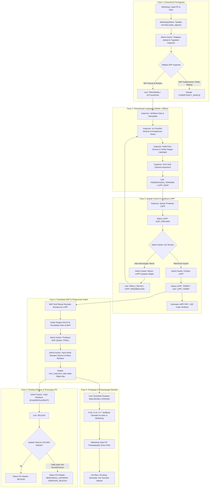

# Handover Discovery, System Architecture & UAT Master Plan
**Proyek:** Sistem Digitalisasi Riksa Uji K3 & Dokumen Operasional — PT Upaya Riksa Daya (URD)  
**Status Audit Terakhir:** READY WITH CONDITIONS (OpenCode Handover)  
**Moda Pemeriksaan:** READ-ONLY DISCOVERY MODE  
**Penyusun:** Antigravity (Principal Product Engineer, Software Architect, Senior Full-Stack Developer, QA Lead, UI/UX Engineer)  
**Tanggal:** 2 November 2026

---

## 1. Project Understanding & Context

PT Upaya Riksa Daya (URD) adalah Perusahaan Jasa Keselamatan dan Kesehatan Kerja (PJK3) yang mengoperasikan sistem internal end-to-end untuk mengelola pengujian objek K3 (Pesawat Angkat & Angkut [PAA], Pesawat Tenaga & Produksi [PTP], Pesawat Uap & Bejana Tekan [PUBT], Instalasi Listrik [LIS], Instalasi Penyalur Petir [IPP], Lift & Eskalator [LE], dan Proteksi Kebakaran [IPK]), penerbitan laporan hasil pemeriksaan dan pengujian (LHPP), berita acara riksa uji (BAP), pelacakan Surat Keterangan (Suket) Disnaker, distribusi berkas resmi, hingga pengingat masa berlaku berkala (renewal reminder).

### Prinsip Utama Sistem
1. **Multi-Unit Independen dalam 1 PO**: Satu Purchase Order (PO) klien dapat memuat $N$ unit alat dari kategori berbeda. Progres setiap unit berjalan mandiri (`order_objects.unit_status`), tidak saling mengunci. Unit yang lolos QC dapat diterbitkan laporannya dan didistribusikan tanpa menunggu unit lain yang memerlukan perbaikan.
2. **Pemisahan Peran Operasional & Komersial**:
   - **Marketing**: Mengelola relasi klien, kontak PIC, pendaftaran PO komersial, data unit, dan tindak lanjut perpanjangan (renewal follow-up).
   - **Admin Kantor**: Mengendalikan quality control (QC), pengembalian draf (revisi), finalisasi laporan teknis LHPP, penerbitan BAP, verifikasi nomor Suket Disnaker, logistik distribusi dokumen fisik/digital, dan arsip.
   - **Inspector (Ahli K3)**: Mengoperasikan aplikasi lapangan secara mobile-first dan offline-ready, memverifikasi nameplate, mengisi butir uji checklist, mengukur data teknis, mendokumentasikan foto temuan, membubuhkan tanda tangan digital, dan mengirimkan draf ke Admin Kantor. Ahli K3 adalah kualifikasi/kompetensi yang divalidasi per kategori objek dan rentang tanggal berlaku SKP, bukan role akun yang berdiri sendiri.
   - **Pimpinan / Manager**: Bersifat **Read-Only Monitoring**. Dilarang melakukan mutasi data operasional (POST/PUT/PATCH/DELETE) dan tidak melakukan verifikasi teknis/approval checklist.
   - **Admin Sistem (Super Admin)**: Mengelola akun pengguna, konfigurasi master data, template checklist, audit log append-only, dan keandalan sistem.

---

## 2. Arsitektur Sistem Aktual

### 2.1 Peta Komponen & Stack Teknologi

| Lapisan | Teknologi / Dependensi | File / Lokasi Kunci | Peran & Karakteristik |
|---|---|---|---|
| **Frontend** | React 19.1, Vite 6.3, Tailwind CSS v4, Phosphor Icons, Axios, React Router 7.6 | `frontend/src/` | SPA terstruktur modul features, offline-ready menggunakan IndexedDB + LocalStorage fallback, mobile responsive drawer + bottom nav |
| **Backend API** | Node.js (ES Module), Express 5.1, Helmet, CORS, Cookie-Parser, Rate-Limit, Joi | `backend/src/app.js`, `backend/src/server.js` | REST API berpagar JWT HttpOnly cookies + Bearer token, CSRF protection via header `X-Requested-With`, validasi Joi schema di setiap route |
| **Database** | PostgreSQL 16 (Local instance port 5433, db `urd_dev` & `urd_test`) | `backend/migrations/` (001-019), `backend/src/database/pool.js` | Skema relasional terindeks, trigger audit log append-only, parameter binding `$1...$n`, integritas Foreign Key |
| **PDF Engine** | PDFKit 0.17 | `backend/src/services/pdf-generator.js` | Engine generasi LHPP dan BAP dinamis dengan layout kategori spesifik (PAA, PTP, PUBT, LIS, IPP, LE, IPK), halaman legalitas PJK3 & SKP Ahli K3, QR verification code |
| **Job Scheduler** | node-cron 3.0 | `backend/src/jobs/reminder-cron.js`, `backend/src/services/client-reminders.js` | Scheduler pengingat berkala otomatis H-30, H-14, H-7 (dan tahapan internal H90..H0) melalui Email (Nodemailer) & WhatsApp (Fonnte gateway) |
| **Offline Storage** | IndexedDB (`urd-offline-sync`) + LocalStorage Fallback | `frontend/src/lib/utils/offline-sync.js` | Penyimpanan antrean lokal draf inspeksi (`drafts`) dan berkas foto lapangan (`photos`) dengan sinkronisasi otomatis saat online kembali |

---

### 2.2 Diagram Alur Data Frontend – Backend – Database

```
+----------------------------------------------------------------------------------------------------+
|                                         FRONTEND (React 19)                                        |
|                                                                                                    |
|  [Marketing Views]       [Inspector (Mobile)]          [Admin Kantor]       [Pimpinan (Read-Only)] |
|   - PO & Clients Form     - Offline Sync (IndexedDB)    - Work Queue QC      - Executive Dashboard |
|   - Renewal Monitor       - Dynamic Checklist           - LHPP Finalization  - Operational KPI     |
|   - Object Management     - Field Photo & Signature     - BAP & Distribution - Audit Drilldown     |
+---------------------------------------+------------------------------------------+-----------------+
                                        | Axios HTTP Client (HttpOnly + CSRF)      |
                                        v                                          v
+----------------------------------------------------------------------------------------------------+
|                                      BACKEND REST API (Express 5)                                  |
|                                                                                                    |
|  [Security & Auth Middleware]                                                                      |
|   - authenticate.js (JWT verify + reload user active status)                                       |
|   - authorize.js (RBAC check + Strict Pimpinan Read-Only mutation guard)                           |
|   - validate.js (Joi schema validation on req.body & params)                                       |
|                                                                                                    |
|  [Modular Routers]                                                                                 |
|   - /orders            - /inspections         - /lhpp               - /bap                         |
|   - /distributions     - /suket               - /reminders          - /portal                      |
|   - /dashboard         - /operational-issues  - /audit-logs         - /verify                      |
|                                                                                                    |
|  [Domain Services]                                                                                |
|   - workflow.js (syncOrderUnitStatus & computePoUnitProgress)                                      |
|   - pdf-generator.js (Category-specific LHPP & BAP generator with QR & SKP attachments)            |
|   - client-reminders.js (Idempotent multi-channel reminder dispatcher)                             |
|   - audit.js (Append-only audit trail logger)                                                      |
+----------------------------------------------------+-----------------------------------------------+
                                                     | pg Pool (Parameterized Queries $1..$n)
                                                     v
+----------------------------------------------------------------------------------------------------+
|                                    POSTGRESQL DATABASE (Port 5433)                                 |
|                                                                                                    |
|  [Core & Master]        [Orders & Units]         [Technical & Documents]  [Compliance & Reminders] |
|   - users, sessions      - orders (PO header)     - inspections, photos    - suket_documents        |
|   - audit_logs           - order_objects (Units)  - lhpp_documents         - renewal_followups      |
|   - clients, contacts    - assignments            - bap_documents          - reminder_dispatches    |
|   - test_objects         - schedules              - lhpp_revisions         - client_reminder_log    |
|   - object_categories    - order_status_history   - bap_revisions          - client_portal_tokens   |
+----------------------------------------------------------------------------------------------------+
```

---

## 3. Matriks Peran & Hak Akses (Role & Permission)

| Fitur / Modul | Marketing | Inspector | Admin Kantor | Pimpinan / Manager | Admin Sistem | Bukti Penegakan (Enforcement) |
|---|---|---|---|---|---|---|
| **Klien & PIC** | Penuh (CRUD) | Baca | Penuh (CRUD) | Baca (Read-only) | Penuh (CRUD) | `backend/src/modules/clients/routes.js` |
| **PO & Unit Objek** | Penuh (CRUD) | Baca penugasan | Penuh (CRUD) | Baca (Read-only) | Penuh (CRUD) | `backend/src/modules/orders/routes.js` |
| **Penjadwalan & Assignment** | Usul / Koordinasi | Baca & tanggapi | Kelola jadwal & penugasan | Baca (Read-only) | Kelola jadwal | Validasi kompetensi SKP: `orders/routes.js:1186` |
| **Inspeksi Lapangan** | Tidak ada | Penuh (Isi, Foto, TTD) | QC & Baca | Baca (Read-only) | Dukungan / Audit | `backend/src/modules/inspections/routes.js` |
| **LHPP QC & Finalisasi** | Tidak ada (dilarang) | Submit draft awal | QC, Finalisasi & Return | Baca (Read-only) | Kelola / Override | `backend/src/modules/lhpp/routes.js:443, 636` |
| **BAP Dokumen** | Tidak ada | TTD Lapangan | Finalisasi & Preview | Baca (Read-only) | Kelola | `backend/src/modules/bap/routes.js` |
| **Suket Disnaker** | Baca status | Tidak ada | Input & Kelola Suket | Baca (Read-only) | Kelola | `backend/src/modules/suket/routes.js` |
| **Distribusi & BAST** | Tidak ada | Tidak ada | Catat pengiriman fisik/digital | Baca (Read-only) | Kelola | `backend/src/modules/distributions/routes.js` |
| **Pengingat Masa Berlaku** | Tindak lanjut komersial | Tidak ada | Tindak lanjut dokumen | Baca (Read-only) | Kelola job & scheduler | `backend/src/modules/reminders/routes.js` |
| **Pimpinan Mutation Guard** | Tidak ada | Tidak ada | Tidak ada | **DIBLOKIR SEMUA (403)** | Tidak ada | `backend/src/middleware/authorize.js:43-47` |
| **User & RBAC Master** | Tidak ada | Tidak ada | Tidak ada | Tidak ada | Penuh (CRUD) | `backend/src/modules/users/routes.js` |

---

## 4. Alur Kerja Bisnis (End-to-End Workflow)

Siklus operasional mengikuti pola **Inversi Dokumen** resmi URD: Inspeksi $\rightarrow$ LHPP $\rightarrow$ BAP $\rightarrow$ Suket $\rightarrow$ Distribusi $\rightarrow$ Renewal.



---

## 5. Status Implementasi Modul Kunci

| Modul | Status Implementasi | File & Bukti Kode | Catatan Penting |
|---|---|---|---|
| **Multi-Unit PO Workflow** | Lengkap & Teruji | `backend/src/services/workflow.js` (`computePoUnitProgress`, `syncOrderUnitStatus`) | Mendukung unit mandiri, agregasi progres PO, proteksi terhadap unit yang dibatalkan |
| **Pemisahan Marketing vs Admin Kantor** | Lengkap & Teruji | `backend/src/middleware/authorize.js:7-8`, `frontend/src/app/router.jsx:31-36` | Pemisahan alias selesai; menu LHPP/BAP/Distribusi terisolasi dari Marketing |
| **Validasi Kompetensi Inspector** | Lengkap & Teruji | `backend/src/modules/orders/routes.js:1186-1198` | Validasi kategori objek terhadap `inspector_competencies`, validasi rentang tanggal sertifikat SKP |
| **Pimpinan Read-Only Guard** | Lengkap & Teruji | `backend/src/middleware/authorize.js:43-47`, `backend/migrations/015_remove_lhpp_manager_approval.sql` | Memblokir semua mutasi HTTP 403; approval teknis LHPP ditiadakan |
| **Offline Inspector Sync** | Lengkap & Teruji di Client | `frontend/src/lib/utils/offline-sync.js` | IndexedDB `urd-offline-sync` + LocalStorage; auto sync online event untuk draf dan foto |
| **LHPP Return / Revision Cycle** | Lengkap & Teruji | `backend/src/modules/lhpp/routes.js:636-724` | Endpoint `POST /lhpp/:id/return` mengembalikan unit ke `PERLU_REVISI` dengan catatan audit |
| **Generasi PDF LHPP 7 Kategori** | Lengkap & Teruji | `backend/src/services/pdf-generator.js` (3023 baris) | Cover, data umum, spesifikasi teknis, checklist, temuan, rekomendasi, QR code publik, SKP Ahli K3 |
| **Pengingat Perpanjangan & Suket** | Lengkap & Teruji | `backend/src/services/client-reminders.js`, `backend/src/modules/reminders/routes.js` | Membaca relasi ganda `suket_id` dan `object_id`; idempotensi dispatch log |
| **Portal Klien Bertoken Hash** | Lengkap & Teruji | `backend/migrations/019_hashed_portal_tokens.sql`, `backend/src/modules/portal/routes.js` | Token disimpan dalam bentuk SHA-256 hash; token plaintext hanya diberikan saat create |

---

## 6. Rencana Pengujian Penerimaan Pengguna (UAT Master Plan)

### 6.1 Desain Skenario UAT: Satu PO, Tiga Unit Berbeda Status

Untuk membuktikan independensi unit dan integritas peran, disiapkan simulasi:
- **Klien**: PT Sinar Industri Perkasa (Dummy)
- **Nomor PO**: `PO-URD-2026-UAT-001`
- **Unit A**: Overhead Crane 15 Ton (Kategori: PAA) $\rightarrow$ **Selesai sampai Suket & Distribusi tanpa revisi**
- **Unit B**: Air Receiver Tank 2000L (Kategori: PUBT) $\rightarrow$ **Ditolak QC Admin Kantor, Perlu Revisi Inspector, lalu Selesai**
- **Unit C**: Instalasi Genset 500 kVA (Kategori: PTP) $\rightarrow$ **Belum Dijadwalkan (Unscheduled)**

### 6.2 Matriks Eksekusi UAT per Peran

| Langkah | Aktor | Tindakan Spesifik | Expected Result | Kriteria Sukses (DoD) |
|---|---|---|---|---|
| **UAT-01** | Marketing | Login ke sistem, buat Klien baru dan catat PO dengan 3 unit (Unit A, B, C) | PO terbentuk dengan status `TERDAFTAR`. Unit A, B, C berstatus `BELUM_DIJADWALKAN` | Data tersimpan di `orders` dan `order_objects`. Audit log mencatat pembuatan PO |
| **UAT-02** | Marketing | Mencoba mengakses rute dokumen `/app/lhpp` atau memanggil endpoint `POST /api/v1/lhpp/:id/finalize` | Navigasi menu tidak menampilkan dokumen teknis; request langsung ditolak dengan HTTP 403 Forbidden | Marketing tidak dapat mengintervensi dokumen QC |
| **UAT-03** | Admin Kantor | Buka Work Queue, tetapkan jadwal untuk Unit A & B, lalu tugaskan Inspector PAA & PUBT | Status Unit A & B berubah menjadi `DITUGASKAN`. Unit C tetap `BELUM_DIJADWALKAN`. Status PO header menjadi `DITUGASKAN` | Validasi SKP lolos; unit independen terbukti |
| **UAT-04** | Inspector PAA | Buka tugas lapangan pada smartphone/tablet, isi data teknis crane, checklist, foto, tanda tangan, lalu submit | Status Unit A berubah menjadi `PEMERIKSAAN_TERKIRIM` $\rightarrow$ `LHPP_DRAF`. Draf LHPP terbit | Form tersimpan di IndexedDB saat offline dan tersinkronisasi ke server |
| **UAT-05** | Inspector PAA | Ajukan finalisasi draf LHPP Unit A (`POST /api/v1/lhpp/:id/submit-finalization`) | Status LHPP Unit A berubah menjadi `SIAP_PREVIEW`. Muncul di Work Queue Admin Kantor | Notifikasi terkirim ke Admin Kantor |
| **UAT-06** | Admin Kantor | Buka pratinjau LHPP Unit A, periksa parameter teknis, klik "Finalisasi LHPP" | Status LHPP menjadi `TERBIT`. Berkas PDF terbuat. Draf BAP otomatis terbentuk. Unit A menjadi `LHPP_TERBIT` | File attachment `LHPP_PDF` tersimpan; QR verifikasi aktif |
| **UAT-07** | Inspector PUBT | Lakukan pemeriksaan Unit B, submit draf, lalu ajukan finalisasi LHPP Unit B | Status LHPP Unit B menjadi `SIAP_PREVIEW` | Siap di-review Admin Kantor |
| **UAT-08** | Admin Kantor | Lakukan QC Unit B, temukan kekurangan catatan ketebalan plat, klik "Kembalikan untuk Revisi" dengan catatan "Mohon lampirkan data ultrasonic thickness gauge minimum 5 titik" | Request diterima. LHPP Unit B status menjadi `DIKEMBALIKAN`. Unit B status menjadi `PERLU_REVISI`. PO header tetap aktif (`MENUNGGU_LAPORAN`) | Unit A tidak terpengaruh sama sekali oleh revisi Unit B |
| **UAT-09** | Inspector PUBT | Buka antrean "Revisi Saya", perbaiki catatan tebal dinding bejana, submit ulang finalisasi | Status LHPP Unit B kembali menjadi `SIAP_PREVIEW` dengan riwayat revisi tercatat di `lhpp_revisions` | Traceability revisi terbukti |
| **UAT-10** | Admin Kantor | Setujui LHPP Unit B yang telah direvisi $\rightarrow$ Finalisasi LHPP | Status Unit B menjadi `LHPP_TERBIT` | Dua unit kini telah memiliki LHPP resmi |
| **UAT-11** | Admin Kantor | Input tanda tangan BAP Unit A & B, finalisasi BAP, input Suket Disnaker untuk Unit A & B | Suket K3 tercatat, masa berlaku baru unit otomatis diupdate ke tanggal Suket | Unit A & B siap didistribusikan |
| **UAT-12** | Admin Kantor | Buat log distribusi dokumen fisik & digital Unit A kepada Klien | Status Unit A menjadi `SELESAI`. Status PO header menjadi `SEBAGIAN_SELESAI` (karena Unit B belum distribusi dan Unit C belum jadwal) | Independensi status PO terbukti nyata |
| **UAT-13** | Pimpinan | Login akun Pimpinan, buka Dasbor dan PO terkait. Coba lakukan klik tombol mutasi atau kirim request POST | Tampilan dasbor menampilkan metrik akurat (1 Selesai, 1 Menunggu Dokumen, 1 Belum Jadwal). Seluruh request mutasi diblokir backend dengan HTTP 403 FORBIDDEN_MUTATION | Sifat monitoring read-only terbukti 100% |
| **UAT-14** | Super Admin | Buka Menu Pengguna, Pengaturan Sistem, dan Log Audit | Seluruh riwayat transaksi (A1 s/d E2) tercatat runtut di `audit_logs` dengan IP dan user ID | Audit trail integritas terbukti |

---

## 7. Temuan Audit, Keterbatasan & Risiko Kritis

### 7.1 Hasil Verifikasi Lingkungan Lokal Saat Ini
1. **Frontend Lint & Build**: LULUS (`npm --prefix frontend run lint` 0 errors, `npm --prefix frontend run build` sukses 4766 modules).
2. **Frontend Unit Tests**: LULUS (`npm --prefix frontend test` 3 files, 7 tests passed).
3. **Backend Lint**: LULUS (`npm --prefix backend run lint` 0 errors).
4. **Backend Contract Test**: LULUS (`frontend-api-contract.test.js` memvalidasi seluruh panggilan API frontend memiliki route backend yang cocok).
5. **Backend Database Test**: Dalam sandboxed discovery mode saat ini, server PostgreSQL lokal pada port 5433 berada dalam kondisi mati (`pg_ctl: no server running`). Uji integrasi database (`api.test.js` dan `search-and-workqueue.test.js`) belum dapat dijalankan dalam sandbox tertutup tanpa permission daemon database.

### 7.2 Keputusan Bisnis Terbuka (Pending Owner Decisions)
Sesuai arahan non-negotiable project, keputusan berikut **tidak boleh diputuskan sepihak oleh developer**:
1. **Jadwal Reminder Resmi**: Pilihan antara tahap internal H90/H60/H30/H14/H0 (migration 005) atau tahap klien H7/H14/H30 (`client-reminders.js` / migration 018).
2. **Lifecycle Koreksi Dokumen Terbit**: Pemilihan kebijakan formal apakah pembatalan/penerbitan ulang LHPP yang sudah terbit menghasilkan dokumen baru dengan relasi `supersedes_id` atau revisi bernomor versi baru.
3. **Kebijakan Retensi Data & Legal Hold**: Masa retensi audit log, foto lapangan, dan berkas PDF sebelum pengarsipan/penghapusan.
4. **Pemetaan Akun Produksi Legacy**: Penentuan pembagian akun lama apakah beralih fungsi ke Marketing murni atau Admin Kantor murni.

---

## 8. Rekomendasi Prioritas Pengerjaan

### Prioritas 1: CRITICAL (Integritas Data, Keamanan & RBAC)
- Memastikan script pengujian database test suite dapat dieksekusi secara terisolasi tanpa menyentuh database operasional.
- Menyelesaikan matriks negative test authorization penuh untuk semua endpoint backend guna memastikan tidak ada celah akses silang peran.

### Prioritas 2: HIGH (Kelancaran Alur Bisnis Inti)
- Melakukan simulasi eksekusi UAT menyeluruh dengan skenario 1 Klien, 1 PO, 3 Unit (Unit A Selesai, Unit B Revisi, Unit C Unscheduled).
- Memastikan visual ringkasan status multi-unit pada halaman PO utama dan Dasbor menampilkan rincian jelas (misal: "1 Selesai \| 1 Perlu Revisi \| 1 Siap Dijadwalkan").

### Prioritas 3: MEDIUM (Pengalaman Pengguna & Uji Responsif)
- Pengujian tampilan antarmuka pada viewport mobile (lebar 375px) untuk alur kerja Inspector di lapangan: kenyamanan pengisian checklist, pengambilan foto, dan tanda tangan digital.
- Verifikasi feedback offline mode dan indikator sinkronisasi pada perangkat mobile ketika sinyal internet tidak stabil.

### Prioritas 4: LOW (Penyempurnaan Kosmetik & Pelaporan)
- Penghalusan hierarki tipografi dan konsistensi badge status dokumen di desktop dan mobile.
- Penyusunan template laporan eksekutif berkala untuk peran Pimpinan/Manager.

