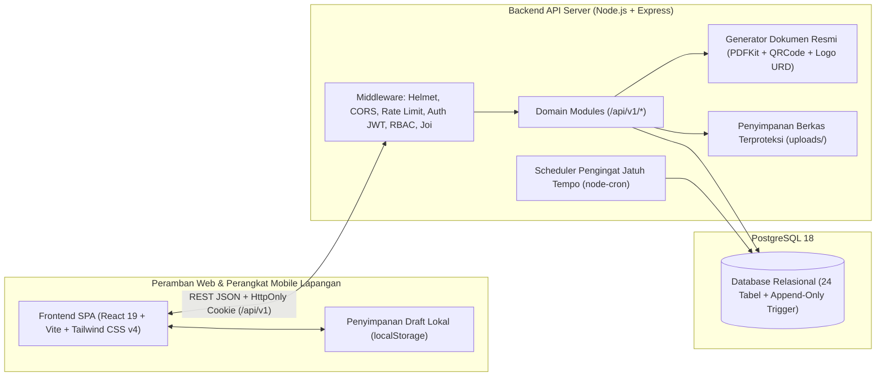

# Arsitektur Sistem (System Overview): PT Upaya Riksa Daya

## 1. Gambaran Umum Arsitektur

Aplikasi operasional internal **PT Upaya Riksa Daya** dirancang dengan arsitektur **Modular Monolith Terpisah** antara lapisan presentasi (`frontend/`) dan layanan API bisnis (`backend/`), didukung oleh database relasional **PostgreSQL** (`pg` driver tanpa ORM).

## 2. Pemisahan Direktori & Tanggung Jawab

- **`/frontend`**:
  - `src/app/`: Inisialisasi aplikasi, konfigurasi React Router, guard autentikasi (`RequireAuth`), guard otorisasi peran (`RequireRole`), dan `AuthProvider`.
  - `src/features/`: Modul antarmuka berbasis domain bisnis (`auth`, `dashboard`, `clients`, `objects`, `orders`, `scheduling`, `inspections`, `lhpp`, `suket`, `reminders`, `users`, `notifications`, `audit-log`).
  - `src/components/`: Komponen reusable (`Badge`, `Modal`, `AppLayout`, `StateViews`).
  - `src/lib/`: Instance Axios dengan interceptor refresh token otomatis dan fungsi pemformatan tanggal/status Bahasa Indonesia.
- **`/backend`**:
  - `migrations/`: Skrip DDL SQL bernomor urut (`001_core.sql` s/d `005_lhpp_suket_reminders.sql`) yang dijalankan secara transaksional.
  - `seeds/`: Data awal operasional realistis untuk pengembangan dan pengujian.
  - `src/middleware/`: Autentikasi JWT (`authenticate.js`), otorisasi peran (`authorize.js`), validasi skema Joi (`validate.js`), dan penanganan error terpusat (`error-handler.js`).
  - `src/modules/`: Endpoint REST API terstruktur per domain bisnis.
  - `src/services/`: Layanan lintas modul (`audit.js`, `notify.js`, `pdf-generator.js`).
  - `src/jobs/`: Evaluasi berkala masa berlaku Suket K3 dan kompetensi Ahli K3 (`reminder-scheduler.js`).

## 3. Alur Proses Bisnis End-to-End

1. **Registrasi Klien & Objek Uji**: Admin Kantor mendaftarkan perusahaan klien, lokasi site, PIC, dan peralatan uji pada 7 bidang K3 (`PAA`, `PTP`, `PUBT`, `LIS`, `IPP`, `LE`, `IPK`).
2. **Pembuatan Order & Penjadwalan**: Admin Kantor membuat order riksa uji, menetapkan jadwal pelaksanaan (divalidasi terhadap bentrok jadwal), dan menugaskan Ahli K3 yang memiliki sertifikat kompetensi aktif pada bidang terkait.
3. **Konfirmasi & Surat Tugas**: Ahli K3 menerima notifikasi penugasan, mengonfirmasi kesediaan (`DITERIMA`), dan mengunduh **Surat Tugas PDF** resmi.
4. **Inspeksi Digital di Lapangan**: Ahli K3 membuka lembar kerja digital berdasarkan template K3, mengisi parameter uji (dengan peringatan otomatis jika pengukuran di luar ambang batas), mencatat temuan beserta foto, membubuhkan tanda tangan digital bersama perwakilan klien, lalu mengunci (`SUBMITTED`) lembar kerja.
5. **Otomasi LHPP & Review Pimpinan**: Penguncian inspeksi secara otomatis menghasilkan draf dokumen **LHPP**. Pimpinan melakukan review teknis dan memberikan persetujuan final (`DISETUJUI_FINAL`) yang menerbitkan nomor unik resmi `LHPP/<BIDANG>/<BULAN_ROMAWI>/<TAHUN>/<URUT>` serta dokumen PDF ber-QR Code verifikasi.
6. **Registri Suket K3 & Siklus Repeat Order**: Setelah Disnaker menerbitkan Surat Keterangan (Suket) K3, Admin Kantor mencatat masa berlakunya dan mengunggah scan dokumen. Sistem mengirimkan pengingat pada `H-90`, `H-60`, `H-30`, `H-14`, dan `H0` serta menyediakan tombol 1-klik untuk membuat **Order Riksa Uji Perpanjangan**.

