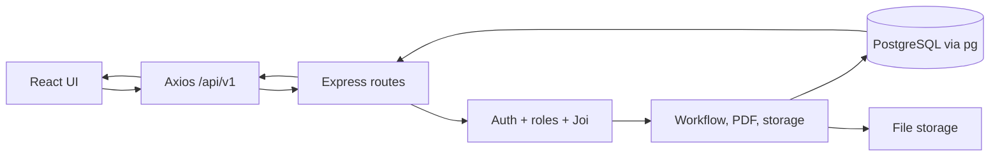
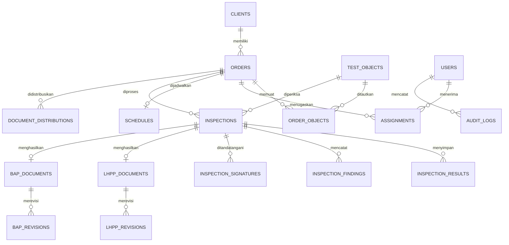

# Peta arsitektur aktual

## Komponen

- `frontend/`: React + Vite, React Router, Axios, Tailwind, Phosphor icons.
- `backend/`: Express, route per domain, middleware authentication/authorization/Joi, service workflow/PDF/notifikasi, storage, scheduler, PostgreSQL `pg`.
- `backend/migrations/`: migrasi SQL 001 sampai 014. API suite menjalankan reset schema sehingga target harus database disposable.

Katalog `urd_dev` menunjukkan 39 tabel publik, 89 foreign key, dan 97 primary/unique/check constraints. ERD ini merangkum relasi inti; belum memetakan seluruh kolom dan index.
