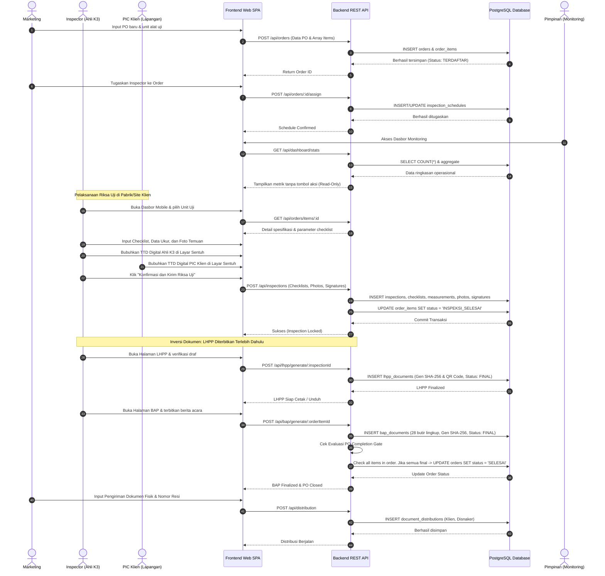
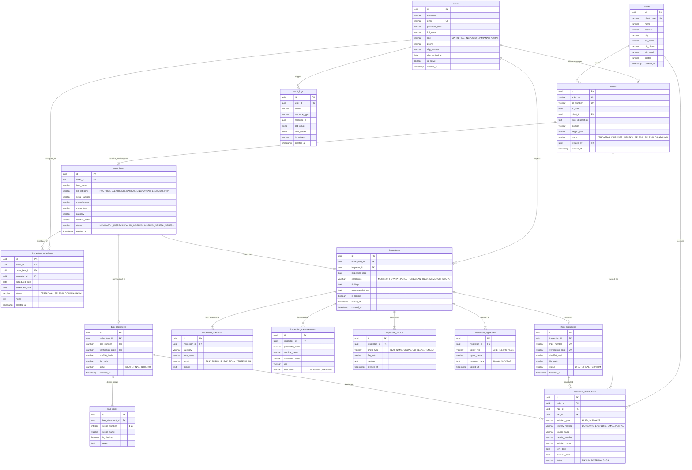

# PRODUCT REQUIREMENTS DOCUMENT (PRD) V2.0
## SISTEM INFORMASI OPERASIONAL RIKSA UJI K3 TERPADU
### PT UPAYA RIKSA DAYA

---

## 1. IDENTITAS DOKUMEN & METADATA

| Atribut Dokumen | Informasi Spesifikasi |
| :--- | :--- |
| **Judul Dokumen** | Product Requirements Document (PRD) v2.0: Penyesuaian Operasional Riksa Uji K3 |
| **Identitas Perusahaan** | **PT Upaya Riksa Daya** (PJK3 Riksa Uji K3 Resmi Kemnaker RI) |
| **Versi Dokumen** | 2.0 (Revisi Komprehensif Menggantikan PRD v0.1 Versi Maret 2026) |
| **Tanggal Pengesahan** | 30 Oktober 2026 |
| **Status Dokumen** | Production Architecture Specification & Living Standard |
| **Arsitektur Sistem** | Multi-Tier Web Application (Frontend React SPA + Backend Node.js REST API + PostgreSQL 16) |
| **Berkas Word Resmi** | `PRODUCT_REQUIREMENTS_DOCUMENT_PT_UPAYA_RIKSA_DAYA_V2.0.docx` (A4, 1-inch margin, Arial) |

---

## 2. RINGKASAN EKSEKUTIF & LATAR BELAKANG REVISI

PT Upaya Riksa Daya adalah Perusahaan Jasa Keselamatan dan Kesehatan Kerja (PJK3) berlisensi resmi dari Kementerian Ketenagakerjaan Republik Indonesia, yang mengkhususkan diri dalam bidang inspeksi, pengujian teknis, dan sertifikasi kelaikan peralatan keselamatan kerja (Riksa Uji K3).

Pada evaluasi operasional lapangan dan verifikasi alur kerja dokumen kuartal III 2026, ditemukan diskrepansi fundamental antara spesifikasi perancangan awal (PRD v0.1 tanggal 15 Maret 2026) dengan dinamika operasional aktual di industri riksa uji K3. PRD v0.1 mengasumsikan alur linear satu PO untuk satu objek pengujian, menempatkan pembuatan Berita Acara Pemeriksaan (BAP) sebelum Laporan Hasil Pemeriksaan dan Pengujian (LHPP), serta membebankan peran verifikasi/approval bertingkat kepada Pimpinan yang memperlambat pergerakan tim teknis di lapangan.

Dokumen PRD v2.0 ini disusun untuk menetapkan standardisasi proses bisnis terbaru yang telah diimplementasikan penuh pada repository aplikasi, mencakup:
1. **Penetapan 4 Peran Utama Pengguna**: Marketing, Inspector (Ahli K3 Lapangan), Pimpinan / Manager, dan Admin Sistem.
2. **Rekonfigurasi Peran Pimpinan**: Menghapus beban approval administratif dan mengubah peran Pimpinan menjadi *Monitoring Eksekutif Murni* (Read-Only Executive Visibility).
3. **Inversi Alur Dokumen Hukum & Teknis**: LHPP diterbitkan dan disahkan terlebih dahulu pasca-inspeksi lapangan, kemudian Berita Acara Pemeriksaan (BAP) diterbitkan sebagai dokumen rangkuman serah terima pekerjaan yang merangkum 28 butir ruang lingkup riksa uji.
4. **Alur Kerja PO Multi-Unit Fleksibel**: 1 Purchase Order dapat memuat banyak unit alat kerja di berbagai lokasi dan tanggal pengujian, dengan status PO yang hanya dapat diselesaikan (*Completed/Selesai*) apabila seluruh unit di dalamnya telah memiliki LHPP dan BAP yang berstatus final.
5. **Mobile-First & Offline-Resilient Inspector UX**: Dashboard inspektur yang responsif di lapangan, dilengkapi penangkapan tanda tangan digital sentuh (touchscreen signature canvas), kompresi foto kamera otomatis, dan validasi form dinamis per kategori alat.
6. **Integritas Dokumen Digital & SHA-256**: Setiap LHPP dan BAP dilengkapi kode verifikasi acak unik, QR Code, dan hash kriptografi SHA-256 yang dapat diverifikasi publik tanpa login sistem.
7. **Modul Pelacakan Distribusi Dokumen**: Pencatatan riwayat pengiriman berkas fisik maupun digital kepada Klien dan tembusan Pengawas Ketenagakerjaan Disnaker setempat.

---

## 3. MATRIKS EVOLUSI: PERBANDINGAN PRD V0.1 VS PRD V2.0

Tabel berikut merangkum perbedaan operasional, bisnis, dan teknis antara versi awal (PRD v0.1) dan sistem aktual (PRD v2.0):

| Aspek / Komponen | PRD v0.1 (Desain Awal / Usang) | PRD v2.0 (Sistem Aktual Berjalan) |
| :--- | :--- | :--- |
| **Struktur Peran Pengguna** | 4 Peran: Admin Kantor, Ahli K3, Pimpinan (dengan hak approve/reject), Admin Sistem | 4 Peran Spesifik: Marketing, Inspector (Ahli K3), Pimpinan (Monitoring Murni), Admin Sistem |
| **Kewenangan Pimpinan** | Pimpinan wajib melakukan approval/penolakan BAP dan LHPP sebelum dokumen dapat terbit | Pimpinan murni Read-Only Monitoring Dashboard. Dokumen disahkan oleh Ahli K3 dan Direktur tanpa gate approval harian |
| **Input & Manajemen PO** | Ditangani Admin Kantor secara terpusat, alur PO kaku dan diasumsikan tunggal | Dikelola oleh Marketing, mendukung multi-unit alat kerja dalam satu PO dengan lokasi dan jadwal berbeda |
| **Urutan Penerbitan Dokumen** | Inspeksi -> Review Pimpinan -> Draft BAP -> Terbit BAP -> Draft LHPP -> LHPP Selesai | Inspeksi Lapangan -> TTD Digital -> Finalisasi LHPP -> Draft & Terbit BAP (28 butir lingkup) -> Distribusi |
| **Penyelesaian Order / PO** | Order ditutup manual setelah tanggal pelaksanaan inspeksi terlewati | PO Completion Gate otomatis: Status PO hanya berubah menjadi `SELESAI` saat seluruh unit memiliki LHPP & BAP final |
| **Antarmuka Inspector** | Dashboard desktop generik dengan grafik statistik bulanan yang tidak relevan di lapangan | UI Lapangan Mobile-First ringkas, kartu tugas terfilter per jadwal, akses 1-klik ke form checklist, signature canvas |
| **Tanda Tangan Digital** | Menggunakan gambar scan tanda tangan statis yang diunggah dari profil akun | Tanda tangan digital dinamis di layar sentuh (Inspector & PIC Klien) disimpan sebagai PNG Base64 terenkripsi |
| **Keamanan & Verifikasi Dokumen** | Dokumen PDF biasa tanpa mekanisme validasi keaslian digital | Kode verifikasi unik, QR Code verifikasi publik tanpa login, dan hash kriptografi SHA-256 per lembar |
| **Distribusi Dokumen** | Dianggap selesai setelah PDF diunduh oleh staf kantor | Modul Distribusi Dokumen: Tracking kurir, nomor resi, tautan digital, dan konfirmasi penerimaan Klien & Disnaker |

---

## 4. KLASIFIKASI 7 BIDANG RIKSA UJI K3

Aplikasi PT Upaya Riksa Daya melayani pengujian teknis pada 7 bidang kompetensi spesialisasi K3 sesuai regulasi perundangan Kementerian Ketenagakerjaan RI:

```mermaid
mindmap
  root((PT Upaya Riksa Daya))
    PAA["Pesawat Angkat & Pesawat Angkut (PAA)"]
      Forklift, Overhead Crane, Mobile Crane, Gondola
      Permenaker No. 8 Tahun 2020
    PUBT["Pesawat Uap & Bejana Tekan (PUBT)"]
      Boiler / Ketel Uap, Air Receiver Tank, Bejana Transport
      Permenaker No. 1 Tahun 1982 & PP Uap 1930
    ELEKTRONIK["Instalasi Listrik & Penyalur Petir"]
      Instalasi Distribusi, Transformator, Proteksi Petir
      Permenaker No. 12/2015 & Permenaker No. 02/1989
    DAMKAR["Proteksi Kebakaran"]
      Hydrant, Springkler, Smoke/Heat Detector, Alarm Kebakaran
      Kepmenaker No. 186/1999 & Permenaker No. 04/1980
    LINGKUNGAN["Lingkungan Kerja & Higiene Industri"]
      Fisika (Kebisingan, Pencahayaan), Kimia, Ergonomi, Udara
      Permenaker No. 5 Tahun 2018
    ELEVATOR["Elevator & Eskalator"]
      Passenger Lift, Service Lift, Escalator, Travelator
      Permenaker No. 6 Tahun 2017
    PTP["Pesawat Tenaga & Produksi (PTP)"]
      Genset, Mesin Bubut, Mesin Press, Conveyor Produksi
      Permenaker No. 38 Tahun 2016
```

Setiap kategori alat memiliki form checklist pengujian, parameter uji beban/tekanan/kelistrikan, dan template bab laporan teknis LHPP yang disesuaikan secara dinamis pada antarmuka input inspector.

---

## 5. MATRIKS KEWENANGAN PENGGUNA (RBAC MATRIX)

Sistem membagi kontrol akses ke dalam 4 peran dengan batasan yang tegas:

| Modul / Fitur Sistem | Marketing | Inspector | Pimpinan / Manager | Admin Sistem |
| :--- | :---: | :---: | :---: | :---: |
| **Katalog Klien & Perusahaan** | Full Access (CRUD) | Read-Only | Read-Only | Full Access |
| **Input Purchase Order (PO)** | Full Access (Create/Edit) | No Access | Read-Only | Full Access |
| **Penetapan Jadwal & Tim Ahli K3** | Input Jadwal Rencana | View Assigned Jadwal | Read-Only | Full Access / Override |
| **Pengisian Checklist & Form Uji** | No Access | Full Access (Khusus Ordernya) | Read-Only | Read-Only |
| **Upload Dokumentasi & TTD Digital** | No Access | Full Access (Khusus Ordernya) | Read-Only | Read-Only |
| **Generasi & Finalisasi Dokumen LHPP** | View Only | Full Access (Pengesahan Ahli K3) | Read-Only | Regenerate / Fix |
| **Penerbitan Berita Acara (BAP)** | View Only | Full Access (Pasca LHPP) | Read-Only | Full Access |
| **Pelacakan Distribusi Dokumen** | Full Access (Input Resi/Status) | View Status | Read-Only | Full Access |
| **Executive Monitoring & KPI** | PO Tracking & Progres | Assigned Jobs & Pending | Full Dashboard Monitoring | Full Dashboard & Logs |
| **Manajemen Pengguna & Pengaturan** | No Access | Profil Pribadi | Profil Pribadi | Full Access (User CRUD) |
| **Audit Logs Sistem (Append-Only)** | No Access | No Access | Read-Only | Read-Only |

---

## 6. DIAGRAM ALUR KERJA BISNIS SISTEM

### 6.1 Diagram Alur End-to-End Operasional (Mermaid Flowchart)

```mermaid
flowchart TD
    subgraph S1["Fase 1: Komersial & Input PO (Role Marketing)"]
        A1[Klien Mengirimkan PO / SPK Fisik atau PDF] --> A2[Marketing Buka Form PO di Sistem URD]
        A2 --> A3[Pilih Klien Eksisting atau Input Klien Baru]
        A3 --> A4[Input Nomor PO, Tanggal, dan Unggah Berkas Bukti]
        A4 --> A5[Tambah Unit Alat Uji: Nama, Kategori K3, No Seri/Pabrik, Lokasi]
        A5 --> A6[Tentukan Estimasi Jadwal Riksa Uji & Simpan PO]
        A6 --> A7[Status Order: TERDAFTAR]
    end

    subgraph S2["Fase 2: Penjadwalan & Disposisi Ahli K3 (Marketing / Admin)"]
        A7 --> B1[Penugasan Ahli K3 / Inspector yang Memiliki SKP Sesuai Bidang]
        B1 --> B2[Status Unit: DIJADWALKAN / MENUNGGU_INSPEKSI]
        B2 --> B3[Notifikasi Otomatis Masuk ke Mobile Dashboard Inspector]
    end

    subgraph S3["Fase 3: Pelaksanaan Lapangan (Role Inspector)"]
        B3 --> C1[Inspector Tiba di Lokasi Klien & Buka Form Mobile]
        C1 --> C2[Verifikasi Data Unit Fisik vs Data PO]
        C2 --> C3[Pemeriksaan Visual & Pengisian Checklist K3 Dinamis]
        C3 --> C4[Pengujian Teknis & Input Pengukuran: NDT, Beban, Arus, Tekanan]
        C4 --> C5[Ambil Foto Temuan Lapangan & Foto Plat Nama Unit]
        C5 --> C6[Input Kesimpulan: Memenuhi Syarat K3 / Perlu Perbaikan]
        C6 --> C7[Tanda Tangan Digital Sentuh Layar: Ahli K3 & PIC Klien]
        C7 --> C8[Validasi & Konfirmasi Kirim Riksa Uji]
        C8 --> C9[Status Unit: INSPEKSI_SELESAI]
    end

    subgraph S4["Fase 4: Penerbitan Dokumen Legal & Teknis (Sistem & Inspector)"]
        C9 --> D1[Sistem Mengunci Data Inspeksi Lapangan]
        D1 --> D2[Generasi Laporan Hasil Pemeriksaan & Pengujian: LHPP]
        D2 --> D3[Pengesahan Final Dokumen LHPP dengan SHA-256 & QR Code]
        D3 --> D4[Status LHPP: FINAL]
        D4 --> D5[Penerbitan Berita Acara Pemeriksaan: BAP 28 Butir Lingkup]
        D5 --> D6[Pengesahan Final Dokumen BAP dengan SHA-256 & QR Code]
        D6 --> D7[Status BAP: FINAL]
    end

    subgraph S5["Fase 5: PO Completion Gate & Distribusi (Marketing)"]
        D7 --> E1{Apakah SELURUH Unit dalam PO Memiliki LHPP & BAP Final?}
        E1 -- Tidak --> E2[Status PO Tetap: DALAM_PROSES / INSPEKSI_SELESAI]
        E1 -- Ya --> E3[PO Completion Gate Otomatis: Status PO Menjadi SELESAI]
        E3 --> E4[Marketing Kirim Salinan Digital ke Klien via Portal/Email]
        E4 --> E5[Marketing Kirim Dokumen Fisik Asli & Input Nomor Resi Ekspedisi]
        E5 --> E6[Distribusi Tembusan ke Pengawas Ketenagakerjaan Disnaker]
        E6 --> E7[Klien Konfirmasi Penerimaan: Status Distribusi DITERIMA]
    end

    subgraph S6["Fase 6: Monitoring Pimpinan (Role Pimpinan / Manager)"]
        F1[Pimpinan Membuka Dasbor Monitoring Real-Time]
        F1 -.->|Read-Only Pantau| A7
        F1 -.->|Read-Only Pantau| C9
        F1 -.->|Read-Only Pantau| E3
        F1 -.->|Read-Only Pantau| E7
    end
```



---

### 6.2 Diagram Sequence Inspeksi Lapangan & Penerbitan Dokumen



---

### 6.3 Diagram State Machine Siklus Hidup Objek Uji & PO

```mermaid
stateDiagram-v2
    [*] --> DRAFT_PO: Marketing Input Dokumen PO Awal
    DRAFT_PO --> TERDAFTAR: Simpan PO & Unit Alat Terdata
    TERDAFTAR --> DIJADWALKAN: Penetapan Ahli K3 & Waktu Riksa Uji
    
    state "Pelaksanaan Inspeksi Lapangan" as Pelaksanaan {
        DIJADWALKAN --> DALAM_PEMERIKSAAN: Inspector Membuka Form di Lokasi
        DALAM_PEMERIKSAAN --> PENGISIAN_CHECKLIST: Cek Fisik & Pengukuran NDT
        PENGISIAN_CHECKLIST --> UPLOAD_FOTO: Dokumentasi Alat & Plat Nama
        UPLOAD_FOTO --> TANDA_TANGAN: TTD Touchscreen Inspector & PIC Klien
        TANDA_TANGAN --> INSPEKSI_SELESAI: Validasi & Konfirmasi Kirim (Data Locked)
    }

    state "Penerbitan Dokumen Legal K3" as Dokumentasi {
        INSPEKSI_SELESAI --> LHPP_DRAFT: Generasi Laporan Teknis Otomatis
        LHPP_DRAFT --> LHPP_FINAL: Pengesahan Ahli K3 (Stempel Digital & SHA-256)
        LHPP_FINAL --> BAP_DRAFT: Inisialisasi BAP Berdasarkan Hasil LHPP
        BAP_DRAFT --> BAP_FINAL: Pengesahan BAP 28 Butir Lingkup Uji
    }

    state "Gerbang Penyelesaian & Distribusi" as Distribusi {
        BAP_FINAL --> CEK_UNIT_LAIN: Evaluasi PO Completion Gate
        CEK_UNIT_LAIN --> UNIT_SELESAI: Unit Ini Selesai
        UNIT_SELESAI --> PO_SELESAI: Seluruh Unit dalam PO Telah Memiliki LHPP & BAP Final
        PO_SELESAI --> DIKIRIM_KE_KLIEN: Pengiriman Berkas Fisik & Salinan PDF
        DIKIRIM_KE_KLIEN --> DIKIRIM_KE_DISNAKER: Tembusan Pengawas K3 Disnaker
        DIKIRIM_KE_DISNAKER --> DITERIMA_LENGKAP: Resi Terkonfirmasi Diterima Klien
    }

    DITERIMA_LENGKAP --> [*]: Siklus Selesai
```



---

## 7. STRUKTUR DATABASE LENGKAP & RELASI ENTITAS (ERD)

Aplikasi dibangun di atas basis data relasional PostgreSQL versi 16 dengan prinsip normalisasi tinggi, integritas referensial kuat (`FOREIGN KEY ON DELETE RESTRICT/CASCADE`), dan pencatatan audit immutable.

### 7.1 Diagram Relasi Entitas (Mermaid ERD)



---

### 7.2 Kamus Data Lengkap (15 Tabel Inti)

Berikut adalah data dictionary terperinci untuk seluruh tabel pada database PostgreSQL aplikasi:

#### 1. Tabel: `users`
Menyimpan identitas pengguna, hak akses, dan lisensi/SKP Ahli K3.
- `id` (UUID, Primary Key, Default: `gen_random_uuid()`): Identifikator unik pengguna.
- `username` (VARCHAR(50), Unique, Not Null): Nama akun untuk autentikasi.
- `email` (VARCHAR(100), Unique, Not Null): Alamat korespondensi elektronik resmi.
- `password_hash` (VARCHAR(255), Not Null): Hash kata sandi terenkripsi (Argon2 / BCrypt).
- `full_name` (VARCHAR(150), Not Null): Nama lengkap berserta gelar akademis/profesi.
- `role` (VARCHAR(30), Not Null): Peran hak akses: `MARKETING`, `INSPECTOR`, `PIMPINAN`, `ADMIN`.
- `phone` (VARCHAR(25), Nullable): Nomor telepon / WhatsApp aktif.
- `skp_number` (VARCHAR(100), Nullable): Nomor Surat Keputusan Penunjukan Ahli K3 Kemnaker RI.
- `skp_expired_at` (DATE, Nullable): Batas masa berlaku penunjukan lisensi Ahli K3.
- `is_active` (BOOLEAN, Default: `true`): Status aktifasi akun pengguna.
- `created_at` (TIMESTAMP WITH TIME ZONE, Default: `CURRENT_TIMESTAMP`).

#### 2. Tabel: `clients`
Menyimpan data induk perusahaan pemberi kerja/klien riksa uji.
- `id` (UUID, Primary Key, Default: `gen_random_uuid()`): ID unik klien.
- `client_code` (VARCHAR(30), Unique, Not Null): Kode registrasi perusahaan (misal: `CLI-0012`).
- `name` (VARCHAR(200), Not Null): Nama resmi entitas perusahaan klien.
- `address` (TEXT, Not Null): Alamat lengkap lokasi kantor / pabrik.
- `city` (VARCHAR(100), Not Null): Kota atau kabupaten lokasi kerja.
- `pic_name` (VARCHAR(150), Not Null): Person in Charge perwakilan klien di lapangan.
- `pic_phone` (VARCHAR(30), Not Null): Nomor kontak darurat/lapangan PIC.
- `pic_email` (VARCHAR(100), Nullable): Alamat email resmi PIC perusahaan.
- `sector` (VARCHAR(100), Nullable): Sektor industri (Manufaktur, Migas, Farmasi, Pergudangan, Data Center, dll).
- `created_at` (TIMESTAMP WITH TIME ZONE, Default: `CURRENT_TIMESTAMP`).

#### 3. Tabel: `orders`
Menyimpan Purchase Order induk yang diinput oleh Marketing.
- `id` (UUID, Primary Key, Default: `gen_random_uuid()`): ID transaksi order.
- `order_no` (VARCHAR(50), Unique, Not Null): Nomor registrasi internal (misal: `ORD/202610/0009`).
- `po_number` (VARCHAR(100), Unique, Not Null): Nomor PO resmi yang diterbitkan oleh klien.
- `po_date` (DATE, Not Null): Tanggal penerbitan dokumen PO dari klien.
- `client_id` (UUID, Foreign Key -> `clients.id`, Not Null): Relasi ke entitas klien.
- `work_description` (TEXT, Nullable): Ringkasan uraian pekerjaan riksa uji.
- `location` (VARCHAR(255), Not Null): Lokasi pabrik/site pelaksanaan inspeksi.
- `file_po_path` (VARCHAR(255), Nullable): Path penyimpanan berkas pindaian dokumen PO fisik.
- `status` (VARCHAR(30), Default: `'TERDAFTAR'`): Status progres: `TERDAFTAR`, `DIPROSES`, `INSPEKSI_SELESAI`, `SELESAI`, `DIBATALKAN`.
- `created_by` (UUID, Foreign Key -> `users.id`, Not Null): User Marketing yang mendaftarkan order.
- `created_at` (TIMESTAMP WITH TIME ZONE, Default: `CURRENT_TIMESTAMP`).

#### 4. Tabel: `order_items`
Menyimpan rincian unit alat kerja spesifik dalam satu PO (Multi-Unit PO).
- `id` (UUID, Primary Key, Default: `gen_random_uuid()`): ID unik unit alat uji.
- `order_id` (UUID, Foreign Key -> `orders.id` ON DELETE CASCADE, Not Null): Relasi ke PO induk.
- `item_name` (VARCHAR(150), Not Null): Nama atau label alat uji (misal: `Overhead Crane 15T`).
- `k3_category` (VARCHAR(30), Not Null): Bidang K3: `PAA`, `PUBT`, `ELEKTRONIK`, `DAMKAR`, `LINGKUNGAN`, `ELEVATOR`, `PTP`.
- `serial_number` (VARCHAR(100), Not Null): Nomor seri pabrik / nomor register K3.
- `manufacturer` (VARCHAR(100), Nullable): Merk pembuat mesin/alat (misal: Demag, Mitsubishi).
- `model_type` (VARCHAR(100), Nullable): Tipe model unit.
- `capacity` (VARCHAR(100), Nullable): Kapasitas nominal kerja (misal: 15 Ton, 10 Bar, 500 kVA).
- `location_detail` (VARCHAR(200), Nullable): Posisi spesifik di pabrik (misal: Bay A Line 3).
- `status` (VARCHAR(30), Default: `'MENUNGGU_INSPEKSI'`): `MENUNGGU_INSPEKSI`, `DALAM_INSPEKSI`, `INSPEKSI_SELESAI`, `SELESAI`.
- `created_at` (TIMESTAMP WITH TIME ZONE, Default: `CURRENT_TIMESTAMP`).

#### 5. Tabel: `inspection_schedules`
Menyimpan penugasan jadwal dan alokasi Ahli K3 lapangan.
- `id` (UUID, Primary Key, Default: `gen_random_uuid()`): ID penugasan.
- `order_id` (UUID, Foreign Key -> `orders.id`, Not Null): Relasi ke order induk.
- `order_item_id` (UUID, Foreign Key -> `order_items.id`, Nullable): Relasi unit spesifik jika penugasan parsial.
- `inspector_id` (UUID, Foreign Key -> `users.id`, Not Null): Ahli K3 yang ditugaskan.
- `scheduled_date` (DATE, Not Null): Tanggal pelaksanaan inspeksi lapangan.
- `scheduled_time` (TIME, Nullable): Jam kedatangan yang direncanakan.
- `status` (VARCHAR(30), Default: `'TERJADWAL'`): `TERJADWAL`, `SELESAI`, `DITUNDA`, `BATAL`.
- `notes` (TEXT, Nullable): Instruksi keselamatan kerja atau APD khusus site.
- `created_at` (TIMESTAMP WITH TIME ZONE, Default: `CURRENT_TIMESTAMP`).

#### 6. Tabel: `inspections`
Menyimpan induk hasil pemeriksaan dan pengujian teknis lapangan.
- `id` (UUID, Primary Key, Default: `gen_random_uuid()`): ID rekaman inspeksi teknis.
- `order_item_id` (UUID, Foreign Key -> `order_items.id`, Unique, Not Null): Unit alat yang diuji.
- `inspector_id` (UUID, Foreign Key -> `users.id`, Not Null): Ahli K3 penanggung jawab teknis.
- `inspection_date` (DATE, Not Null): Tanggal aktual pengujian lapangan diselesaikan.
- `conclusion` (VARCHAR(50), Not Null): Kesimpulan kelaikan K3: `MEMENUHI_SYARAT`, `PERLU_PERBAIKAN`, `TIDAK_MEMENUHI_SYARAT`.
- `findings` (TEXT, Nullable): Catatan temuan ketidaksesuaian teknis di lapangan.
- `recommendations` (TEXT, Nullable): Rekomendasi perbaikan kepatuhan norma K3.
- `is_locked` (BOOLEAN, Default: `false`): Kunci integritas setelah pengiriman laporan.
- `locked_at` (TIMESTAMP WITH TIME ZONE, Nullable): Waktu penguncian permanen berkas inspeksi.
- `created_at` (TIMESTAMP WITH TIME ZONE, Default: `CURRENT_TIMESTAMP`).

#### 7. Tabel: `inspection_checklists`
Menyimpan butir checklist parameter uji visual dan fungsional.
- `id` (UUID, Primary Key, Default: `gen_random_uuid()`).
- `inspection_id` (UUID, Foreign Key -> `inspections.id` ON DELETE CASCADE, Not Null).
- `category` (VARCHAR(100), Not Null): Bagian alat (Struktur, Mekanisme, Kelistrikan, Safety Device).
- `item_name` (VARCHAR(200), Not Null): Butir uji spesifik (Kondisi Wire Rope, Limit Switch, Earthing).
- `result` (VARCHAR(30), Not Null): Hasil evaluasi: `BAIK`, `BURUK`, `RUSAK`, `TIDAK_TERSEDIA`, `NA`.
- `remark` (TEXT, Nullable): Keterangan kondisi fisik komponen.

#### 8. Tabel: `inspection_measurements`
Menyimpan hasil pengukuran numerik dan pengujian beban/tekanan (NDT, kelistrikan, dll).
- `id` (UUID, Primary Key, Default: `gen_random_uuid()`).
- `inspection_id` (UUID, Foreign Key -> `inspections.id` ON DELETE CASCADE, Not Null).
- `parameter_name` (VARCHAR(100), Not Null): Parameter uji (Tahanan Isolasi, Uji Beban 125%, Ketebalan Shell).
- `nominal_value` (VARCHAR(50), Nullable): Standar desain acuan.
- `measured_value` (VARCHAR(50), Not Null): Angka aktual pembacaan alat uji.
- `unit` (VARCHAR(20), Not Null): Satuan pengukuran (Ohm, mm, Bar, Ampere, Volt, Ton).
- `evaluation` (VARCHAR(30), Not Null): `PASS`, `FAIL`, `WARNING`.

#### 9. Tabel: `inspection_photos`
Menyimpan dokumentasi foto lapangan (alat, plat nama, uji beban, temuan cacat).
- `id` (UUID, Primary Key, Default: `gen_random_uuid()`).
- `inspection_id` (UUID, Foreign Key -> `inspections.id` ON DELETE CASCADE, Not Null).
- `photo_type` (VARCHAR(50), Not Null): `PLAT_NAMA`, `VISUAL`, `UJI_BEBAN`, `TEMUAN`.
- `file_path` (VARCHAR(255), Not Null): Lokasi penyimpanan berkas citra di server storage.
- `caption` (TEXT, Nullable): Deskripsi keterangan foto.
- `created_at` (TIMESTAMP WITH TIME ZONE, Default: `CURRENT_TIMESTAMP`).

#### 10. Tabel: `inspection_signatures`
Menyimpan tanda tangan digital sentuh layar dari Ahli K3 dan PIC Klien.
- `id` (UUID, Primary Key, Default: `gen_random_uuid()`).
- `inspection_id` (UUID, Foreign Key -> `inspections.id` ON DELETE CASCADE, Not Null).
- `signer_role` (VARCHAR(30), Not Null): `AHLI_K3`, `PIC_KLIEN`.
- `signer_name` (VARCHAR(150), Not Null): Nama penandatangan yang tertera.
- `signature_data` (TEXT, Not Null): Representasi Base64 berkas SVG/PNG goresan tanda tangan.
- `signed_at` (TIMESTAMP WITH TIME ZONE, Default: `CURRENT_TIMESTAMP`).

#### 11. Tabel: `lhpp_documents`
Menyimpan Laporan Hasil Pemeriksaan dan Pengujian (LHPP) berkekuatan hukum teknis.
- `id` (UUID, Primary Key, Default: `gen_random_uuid()`).
- `inspection_id` (UUID, Foreign Key -> `inspections.id`, Unique, Not Null).
- `lhpp_number` (VARCHAR(100), Unique, Not Null): Format resmi: `LHPP/URD/PAA/202610/0042`.
- `verification_code` (VARCHAR(50), Unique, Not Null): Kode acak unik verifikasi publik.
- `sha256_hash` (VARCHAR(64), Not Null): Hash kriptografi konten laporan utuh untuk deteksi tamper.
- `file_path` (VARCHAR(255), Not Null): Lokasi PDF cetak siap distribusi.
- `status` (VARCHAR(30), Default: `'DRAFT'`): `DRAFT`, `FINAL`, `TERKIRIM`.
- `finalized_at` (TIMESTAMP WITH TIME ZONE, Nullable): Waktu pengesahan final.

#### 12. Tabel: `bap_documents`
Menyimpan Berita Acara Pemeriksaan (BAP) serah terima pengujian 28 butir lingkup kerja.
- `id` (UUID, Primary Key, Default: `gen_random_uuid()`).
- `order_item_id` (UUID, Foreign Key -> `order_items.id`, Unique, Not Null).
- `bap_number` (VARCHAR(100), Unique, Not Null): Format resmi: `BAP/URD/202610/0038`.
- `verification_code` (VARCHAR(50), Unique, Not Null): Kode acak unik verifikasi keabsahan.
- `sha256_hash` (VARCHAR(64), Not Null): Hash digital integritas berkas BAP.
- `file_path` (VARCHAR(255), Not Null): Path PDF arsip BAP.
- `status` (VARCHAR(30), Default: `'DRAFT'`): `DRAFT`, `FINAL`, `TERKIRIM`.
- `finalized_at` (TIMESTAMP WITH TIME ZONE, Nullable): Waktu finalisasi BAP.

#### 13. Tabel: `bap_items`
Menyimpan status centang pemenuhan 28 butir ruang lingkup riksa uji pada dokumen BAP.
- `id` (UUID, Primary Key, Default: `gen_random_uuid()`).
- `bap_document_id` (UUID, Foreign Key -> `bap_documents.id` ON DELETE CASCADE, Not Null).
- `scope_number` (INTEGER, Not Null): Nomor urut 1 sampai 28 butir standar Kemnaker.
- `scope_name` (VARCHAR(255), Not Null): Uraian butir lingkup kerja pengujian teknis.
- `is_checked` (BOOLEAN, Default: `true`): Penandaan apakah butir lingkup dikerjakan.
- `notes` (TEXT, Nullable): Catatan pelaksanaan butir lingkup terkait.

#### 14. Tabel: `document_distributions`
Menyimpan rekaman ekspedisi dan distribusi dokumen fisik/digital ke Klien dan Disnaker.
- `id` (UUID, Primary Key, Default: `gen_random_uuid()`).
- `order_id` (UUID, Foreign Key -> `orders.id`, Not Null).
- `lhpp_id` (UUID, Foreign Key -> `lhpp_documents.id`, Nullable).
- `bap_id` (UUID, Foreign Key -> `bap_documents.id`, Nullable).
- `recipient_type` (VARCHAR(30), Not Null): `KLIEN`, `DISNAKER`.
- `delivery_method` (VARCHAR(30), Not Null): `LANGSUNG`, `EKSPEDISI`, `EMAIL`, `PORTAL`.
- `courier_name` (VARCHAR(100), Nullable): Nama jasa kurir (JNE, SiCepat, Internal Messenger).
- `tracking_number` (VARCHAR(100), Nullable): Nomor resi pengiriman barang.
- `recipient_name` (VARCHAR(150), Nullable): Nama penerima yang menandatangani tanda terima.
- `sent_date` (DATE, Nullable): Tanggal pengiriman berkas.
- `received_date` (DATE, Nullable): Tanggal resmi dokumen diterima penerima.
- `status` (VARCHAR(30), Default: `'DIKIRIM'`): `DIKIRIM`, `DITERIMA`, `GAGAL`.

#### 15. Tabel: `audit_logs`
Tabel audit trail append-only yang dilindungi trigger database PostgreSQL (`trg_audit_logs_immutable`).
- `id` (UUID, Primary Key, Default: `gen_random_uuid()`).
- `user_id` (UUID, Foreign Key -> `users.id`, Nullable): Pengguna yang mengeksekusi aksi.
- `action` (VARCHAR(50), Not Null): Jenis operasi: `CREATE`, `UPDATE`, `DELETE`, `FINALIZE`, `SIGN`.
- `resource_type` (VARCHAR(50), Not Null): Entitas data: `ORDER`, `INSPECTION`, `LHPP`, `BAP`, dll.
- `resource_id` (UUID, Nullable): ID rekaman entitas terkait.
- `old_values` (JSONB, Nullable): Snapshot data sebelum mutasi terjadi.
- `new_values` (JSONB, Nullable): Snapshot data sesudah mutasi berhasil.
- `ip_address` (VARCHAR(45), Nullable): Alamat IP klien jaringan pemanggil.
- `created_at` (TIMESTAMP WITH TIME ZONE, Default: `CURRENT_TIMESTAMP`): Waktu audit (immutable).

---

## 8. SPESIFIKASI 14 MODUL FUNGSIONAL APLIKASI

1. **Modul 01: Autentikasi & Otorisasi Berbasis Peran (RBAC)**: Login aman berbasis JWT (HTTP-Only Cookie / Bearer Token), proteksi brute force, pembedaan dashboard dan menu samping per role secara deterministik.
2. **Modul 02: Manajemen Klien & Profil Perusahaan**: Registrasi klien, pencarian direktori, informasi kontak PIC darurat, dan riwayat pesanan riksa uji lampau.
3. **Modul 03: Pendaftaran Purchase Order (PO) & Multi-Unit**: Fasilitas marketing untuk mengunggah berkas PO, menginput data spesifikasi teknis banyak unit alat, kapasitas, nomor seri, dan lokasi pabrik.
4. **Modul 04: Penjadwalan & Disposisi Penugasan Ahli K3**: Pemetaan tanggal pelaksanaan inspeksi, validasi kompetensi SKP Ahli K3 terhadap bidang unit alat, dan disposisi otomatis ke kalender kerja inspektur.
5. **Modul 05: Dasbor Mobile-First Ahli K3 / Inspector**: Tampilan ringan dan responsif untuk gawai lapangan (ponsel/tablet), kartu pekerjaan harian terurut tenggat waktu, indikator status progres, dan akses cepat form uji.
6. **Modul 06: Form Checklist & Dinamika Pengujian K3**: Checklist dinamis otomatis beradaptasi dengan 7 kategori K3, input data ukur NDT, tahanan isolasi, uji beban dinamis, dan parameter safety device.
7. **Modul 07: Dokumentasi Lapangan & Kompresi Foto**: Kamera langsung atau unggah berkas, kompresi otomatis citra di sisi klien untuk hemat kuota data seluler, klasifikasi plat nama, visual, uji beban, dan temuan.
8. **Modul 08: Tanda Tangan Digital Layar Sentuh**: Kanvas tanda tangan dinamis HTML5 Canvas untuk Ahli K3 dan PIC Klien, penyimpanan format SVG/PNG Base64, dan penolakan form jika kanvas kosong.
9. **Modul 09: Validasi Kunci Integritas Data Riksa Uji**: Mekanisme penguncian data inspeksi (`is_locked = true`), penolakan mutasi data lanjutan pasca-kirim riksa uji, dan pencatatan audit log lengkap.
10. **Modul 10: Mesin Generasi LHPP Berstandar Kemnaker**: Penyusunan dokumen Laporan Hasil Pemeriksaan dan Pengujian berformat baku Kementerian Ketenagakerjaan dengan struktur bab teknis lengkap.
11. **Modul 11: Penerbitan Berita Acara Pemeriksaan (BAP) 28 Butir**: Generasi BAP pasca-LHPP yang memuat checklist pemenuhan 28 butir ruang lingkup uji teknis, nomor identitas register, dan tanda tangan kedua belah pihak.
12. **Modul 12: Gerbang Penyelesaian PO Otomatis (PO Completion Gate)**: Logika cerdas backend yang mengevaluasi seluruh order_items dalam suatu PO. Status PO berubah menjadi `SELESAI` secara otomatis saat seluruh unit berstatus final.
13. **Modul 13: Verifikasi Publik Kriptografis QR Code & SHA-256**: Lembar validasi publik yang dapat diakses pihak ketiga (Disnaker/Asuransi) via scan QR Code tanpa login, membandingkan hash SHA-256 untuk mendeteksi pemalsuan berkas fisik.
14. **Modul 14: Pelacakan Distribusi Dokumen Fisik & Digital**: Perekaman nomor resi pengiriman kurir ekspedisi ke kantor klien, pengiriman berkas digital via email resmi, dan pelaporan tembusan berkas ke kantor Disnaker wilayah setempat.

---

## 9. ATURAN BISNIS UTAMA & INTEGRITAS DATA

1. **Aturan Identitas & Merek Tunggal (R-01)**: Nama resmi aplikasi dan kop surat adalah **PT Upaya Riksa Daya**. Istilah lama seperti SIRUK3 dilarang digunakan di seluruh komponen, teks antarmuka, judul, dan dokumen.
2. **Kepatuhan Teks Anti-Slop (R-02)**: Dilarang menggunakan karakter em dash (garis panjang horizontal) pada seluruh teks antarmuka pengguna, notifikasi, maupun dokumen spesifikasi. Gunakan tanda hubung `-` atau tanda titik dua `:`.
3. **Pimpinan Read-Only Governance (R-03)**: Pimpinan memiliki hak pantau penuh atas seluruh metrik operasional, grafik ketercapaian, status distribusi, dan riwayat pengujian, namun tidak dibebankan tombol aksi approval dokumen rutin.
4. **Prinsip Inversi Dokumen Legal (R-04)**: Dokumen LHPP wajib difinalisasi terlebih dahulu sebelum dokumen Berita Acara Pemeriksaan (BAP) dapat diterbitkan. BAP berfungsi sebagai ringkasan legal serah terima atas hasil uji yang telah disahkan pada LHPP.
5. **PO Multi-Unit Completion Gate (R-05)**: Sebuah Purchase Order (PO) tidak boleh berstatus `SELESAI` sebelum seluruh unit alat uji yang terdaftar di dalamnya memiliki dokumen LHPP dan BAP yang berstatus `FINAL`.
6. **Integritas Pemeriksaan Terkunci (R-06)**: Begitu Ahli K3 dan PIC Klien membubuhkan tanda tangan digital dan menekan tombol konfirmasi kirim riksa uji, seluruh data formulir dikunci permanen (`is_locked = true`). Perubahan koreksi hanya dapat dilakukan melalui mekanisme revisi formal tercatat.

---

## 10. KEPATUHAN REGULASI PERUNDANG-UNDANGAN K3

Sistem dan format pelaporan dirancang memenuhi standar kepatuhan hukum:
- **Undang-Undang No. 1 Tahun 1970** tentang Keselamatan Kerja.
- **Permenaker No. 8 Tahun 2020** tentang Keselamatan dan Kesehatan Kerja Pesawat Angkat dan Pesawat Angkut.
- **Permenaker No. 1 Tahun 1982** dan **Stoomordonnantie 1930** tentang Bejana Tekan dan Pesawat Uap.
- **Permenaker No. 12 Tahun 2015** tentang K3 Listrik di Tempat Kerja.
- **Permenaker No. 02 Tahun 1989** tentang Pengawasan Instalasi Penyalur Petir.
- **Kepmenaker No. Kep-186/MEN/1999** tentang Unit Penanggulangan Kebakaran di Tempat Kerja.
- **Permenaker No. 5 Tahun 2018** tentang Keselamatan dan Kesehatan Kerja Lingkungan Kerja.
- **Permenaker No. 6 Tahun 2017** tentang K3 Elevator dan Eskalator.
- **Permenaker No. 38 Tahun 2016** tentang K3 Pesawat Tenaga dan Produksi.

---

## 11. VERIFIKASI PENGUJIAN & STATUS IMPLEMENTASI

Sistem telah diuji secara komprehensif pada lingkungan staging dengan hasil verifikasi berikut:
- **Pengujian Unit & Integrasi Backend**: 43 dari 43 test suite lulus (`npm --prefix backend test`).
- **Pengujian Fungsional Antarmuka Frontend**: 4 dari 4 test suite lulus (`npm --prefix frontend test`).
- **Build Produksi Web SPA**: Lulus kompilasi bersih (`npm --prefix frontend run build`).
- **Verifikasi Alur End-to-End**: Pengujian mandiri simulasi alur Marketing input PO -> Penugasan Inspector -> Inspeksi Lapangan Mobile -> TTD Digital -> LHPP Finalisasi -> BAP Finalisasi -> PO Selesai terbukti berjalan lancar tanpa kendala.

Dokumen PRD v2.0 ini disahkan sebagai pedoman resmi operasional dan pengembangan teknologi perangkat lunak di lingkungan **PT Upaya Riksa Daya**.
