# PT Upaya Riksa Daya (URD) — End-to-End Business Workflow Map

Dokumen ini memetakan alur operasional K3 menyeluruh (*end-to-end*) pada PT Upaya Riksa Daya, merinci peran aktor, prasyarat tindakan (*preconditions*), transisi status unit dan PO, penulisan data, notifikasi, serta jaminan penanganan kegagalan.

---

## 1. Diagram Alur Kerja Operasional K3 URD

```mermaid
flowchart TD
    %% Roles & Phases
    subgraph Phase1["1. Tahap Komersial & PO (Marketing)"]
        M1[Registrasi Klien & Multi-PIC] --> M2[Pendaftaran Unit Objek Uji K3]
        M2 --> M3[Pembuatan PO Multi-Unit]
        M3 --> M4[Status PO: TERDAFTAR<br/>Unit: BELUM_DIJADWALKAN]
    end

    subgraph Phase2["2. Penjadwalan & Penugasan (Admin Kantor)"]
        A1[Tetapkan Rentang Tanggal Inspeksi] --> A2[Validasi Lisensi SKP & Bidang K3 Ahli K3]
        A2 --> A3[Pemeriksaan Jadwal Bentrok]
        A3 --> A4[Terbitkan Surat Tugas PDF & Tugaskan Inspector]
        A4 --> A5[Status Unit: DITUGASKAN]
    end

    subgraph Phase3["3. Riksa Uji Lapangan (Inspector / Ahli K3)"]
        I1[Buka Penugasan Lapangan Online/Offline] --> I2[Mulai Inspeksi -> Unit: SEDANG_DIINSPEKSI]
        I2 --> I3[Isi Dynamic Checklist Spesifik Nama Alat]
        I3 --> I4[Input Nilai Pengukuran Teknis & Dimensi]
        I4 --> I5[Unggah Foto Pelat Nama & Komponen Kritis]
        I5 --> I6[Catat Temuan & Rekomendasi K3]
        I6 --> I7[Tanda Tangan Digital Ahli K3 & PIC Klien]
        I7 --> I8[Submit Hasil Inspeksi -> Unit: FORM_TERKIRIM]
    end

    subgraph Phase4["4. Quality Control & Finalisasi Berkas (Admin Kantor)"]
        QC1{Review QC Admin Kantor}
        QC1 -- "Ada Ketidaksesuaian" --> QC_REV[Minta Revisi Spesifik Seksi -> Unit: PERLU_REVISI]
        QC_REV --> I_REV[Inspector Perbaiki Seksi Terkait & Submit Ulang]
        I_REV --> QC1
        QC1 -- "Lolos QC" --> QC_PASS[Pratinjau PDF & DOCX LHPP]
        QC_PASS --> L1[Finalisasi LHPP Resmi -> Unit: LHPP_FINAL<br/>SHA-256 Hash + Snapshot Beku]
        L1 --> B1[Otomatis Terbitkan Draf BAP]
        B1 --> B2[Finalisasi BAP Resmi -> Unit: BAP_FINAL]
        B2 --> S1[Input No. Suket Disnaker & Cetak Stiker QR]
    end

    subgraph Phase5["5. Distribusi & Serah Terima Dokumen (Admin Kantor)"]
        D1[Siapkan Berkas Lengkap: LHPP + BAP + Suket + Stiker QR]
        D1 --> D2[Buat Distribusi Email & Kurir Fisik]
        D2 --> D3[Cetak Berita Acara Serah Terima BAST PDF]
        D3 --> D4[Input Nomor Resi / Unggah Bukti Terima Klien]
        D4 --> D5[Status Distribusi: DITERIMA<br/>Status Unit: SELESAI]
    end

    subgraph Phase6["6. Evaluasi Status PO & Eksekutif (Pimpinan & Marketing)"]
        E1{Seluruh Unit dalam PO SELESAI?}
        E1 -- "Belum (Sebagian Masih Proses)" --> E2[PO Tetap Berjalan / Status Parsial]
        E1 -- "Ya (100% Unit Selesai)" --> E3[Status PO Otomatis: SELESAI]
        E3 --> R1[Pengingat Otomatis Siklus Riksa Berkala H-90, H-60, H-30]
        R1 --> M_REN[Marketing Tindak Lanjut Renewal PO]
    end

    %% Flow transitions
    M4 --> A1
    A5 --> I1
    I8 --> QC1
    S1 --> D1
    D5 --> E1
```



---

## 2. Prinsip Multi-Unit Independen dalam 1 PO

Satu Purchase Order (PO) yang diterbitkan oleh Marketing dapat menaungi banyak unit alat uji yang memiliki bidang, kelompok, dan karakteristik berbeda (misal: Unit 1 Overhead Crane PAA, Unit 2 Boiler PUBT, Unit 3 Genset PTP).

Sistem menerapkan arsitektur *Decoupled Unit Lifecycle*:
1. **Independensi Penjadwalan**: Unit 1 dan Unit 2 dapat dijadwalkan pada hari berbeda dengan Inspector yang memiliki kompetensi berbeda.
2. **Independensi Inspeksi**: Inspector Unit 1 dapat mengirimkan formulir lapangan tanpa perlu menunggu Inspector Unit 2 selesai.
3. **Independensi Quality Control & Revisi**: Jika Unit 2 membutuhkan revisi isian pengukuran, Unit 1 yang sudah lolos QC dapat langsung difinalisasi LHPP dan BAP-nya tanpa tertahan oleh revisi Unit 2.
4. **Independensi Penerbitan Dokumen**: LHPP, BAP, Suket, dan BAST untuk Unit 1 dapat segera diserahkan kepada klien.
5. **PO Completion Gate**: PO hanya akan berstatus `SELESAI` apabila seluruh unit di dalamnya telah berhasil menyelesaikan seluruh siklus hidup hingga tahap serah terima berkas (`unit_status = 'SELESAI'`).

---

## 3. Penegakan Urutan Rilis Dokumen (Document Issuance Pipeline)

Sistem memastikan bahwa alur penerbitan dokumen resmi mematuhi standar legal ketenagakerjaan dan SOP teknis URD:

```
Hasil Inspeksi Lapangan 
       ↓
Draf LHPP Terbit Otomatis
       ↓
Quality Control (QC) Admin Kantor (Revisi jika ada ketidaksesuaian)
       ↓
Pratinjau PDF / DOCX LHPP (Identik dengan cetak fisik)
       ↓
[WAJIB] Finalisasi LHPP Resmi (Pemberian No. Resmi, SHA-256 Hash, Snapshot Data)
       ↓
Draf BAP Terbit Otomatis
       ↓
Penandatanganan & Verifikasi BAP
       ↓
[WAJIB] Finalisasi BAP Resmi (Ditolak jika LHPP belum FINAL)
       ↓
Penerbitan Suket Disnaker, Cetak Stiker QR Tahan Air & Berkas BAST
```

---

## 4. Keandalan Mode Offline Inspector (*Offline-First Field Mobility*)

Inspector di lapangan sering kali menghadapi area kerja tanpa sinyal telekomunikasi (*blind spot* pabrik bawah tanah, kilang lepas pantai, area pedalaman).

Sistem menangani kondisi ini melalui:
1. **Local Caching via IndexedDB**:
   - Seluruh daftar penugasan, data teknis unit, dan butir checklist dinamis di-cache ke dalam IndexedDB peramban saat Inspector daring (*online*).
2. **Pengisian Formulir Luring**:
   - Inspector dapat mengisi setiap butir checklist, memasukkan angka pengukuran, dan mengambil foto dokumentasi tanpa sambungan internet.
   - Status penyimpanan lokal ditandai dengan lencana jelas (*Saved Locally*).
3. **Antrean Sinkronisasi Otomatis (*Sync Queue*)**:
   - Ketika koneksi internet terdeteksi kembali (*online event*), sistem secara otomatis memvalidasi keutuhan draf lokal dan menyinkronkan data ke server Express secara berurutan (*sequential idempotent sync*).
   - Mencegah konflik data melalui mekanisme *Last-Modified Check*.

